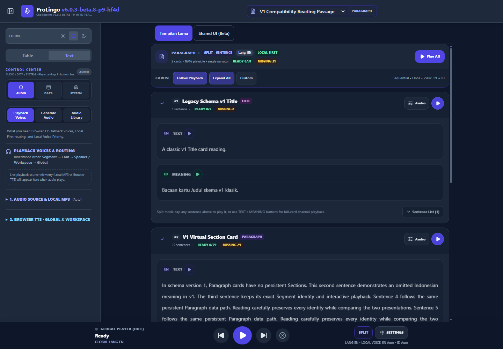
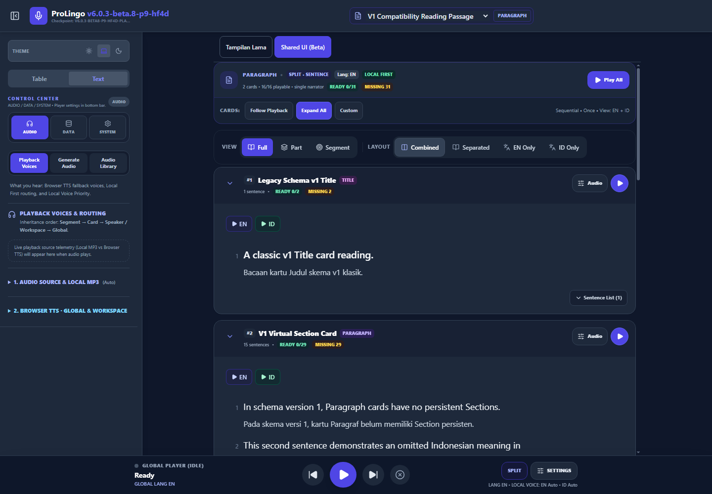
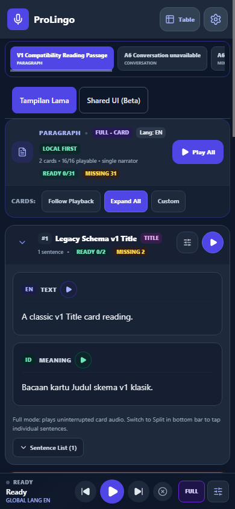
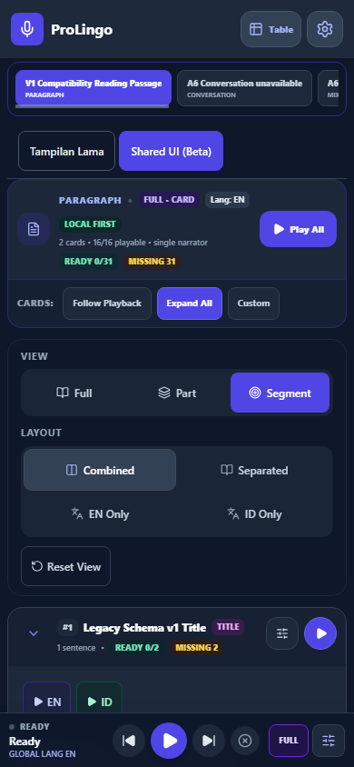

# P12-A6 — Main Text Dual Reader Integration

Date: 2026-11-17. Repository: `nazurinian/prolingo-app`.

**CONDITIONAL GO for local Paragraph pilot acceptance.** The real main Text tab now offers **Tampilan Lama** and **Shared UI (Beta)** using the same hydrated Workspace and existing playback host. Fresh preferences default to Tampilan Lama. Automated acceptance passes; native audible playback and Android acceptance of this new main-tab integration remain human checks. No commit, push, deployment, migration or P13 implementation was performed.

## 1. Source state and preflight

Working directory:

`C:\Users\HikamSeif\Documents\@ Lain-Lain\2000 Most Frequently Used Words\prolingo-p12-integration-qa`

- Starting branch: `feature/p12-conversation-only`; clean working tree, no pending integration operation.
- Actual starting/current committed HEAD: **`4a7ecffacc54bc972129e5dcd54737f08e7ddd9a`**.
- This differs from the supplied last-verified `7712866a42620b5b31043978e9424ea0d576f082` because the next local commit records R1 stabilization: two browser-test files and its report. Its application-source diff against `7712866` is empty. No pull/reset/rebase or discarded work was necessary.
- Created the authorized local branch with `git switch -c feature/p12-a6-main-text-dual-view`. It remains at the same committed HEAD; all A6 changes are uncommitted.
- Original Conversation branch remains at `4a7ecffacc54bc972129e5dcd54737f08e7ddd9a`.
- Shared UI branch remains at `dc3722c173793aed124ae4bee98092377d62b795`.
- Backup `backup/p12-conversation-before-shared-a5` remains at `a85bb63be2dcb2fad69f31e6ea7654ef9fcf35bd`.
- Existing source and AI Voice worktrees were preserved. No additional worktree was created.

The P12 integration and R1 reports were consulted. R1 is **closed**, with its committed test synchronization correction retained unchanged; see section 6.

## 2. Implementation and exact integration path

The implementation reuses the accepted embedded integration in `TextStructuredPlayer`, rather than replacing the main player.

`executeTextLibraryBootstrapEffect → canonical v1 hydration → textLibrarySnapshot + activeTextDocumentId → selectTextMainReaderPresentation → selectTextCardPresentation → TextStructuredPlayer Shared props → SharedCardReadingSurface`.

- `src/App.jsx:853`: independent reader/view preference and memoized eligibility for the active snapshot/document.
- `src/App.jsx:4171`: observe the existing `onPlaybackCursor` callback to capture its actual engine session, originating snapshot object and Workspace identity.
- `src/App.jsx:7497`: adapt scoped host evidence through the existing A1 cursor adapter.
- `src/App.jsx:7514`: supply the existing `useSharedCardReader`, `sharedPresentation`, `sharedPresentationState`, change callback and `sharedPlaybackCursor` props.
- `src/App.jsx:7663`: reader choice above the existing player, with a stable parent tree across reader-mode changes.

Both choices keep the same `TextStructuredPlayer` instance and original Card shell. Its audio panels, generation/download/export entry points, expansion controls, sidebar and bottom player remain available. The existing Paragraph reading implementation and Shared rendering components were not edited.

### Eligibility and fallback

| Input | Behavior |
| --- | --- |
| Loaded, validated Paragraph-only structured Workspace | Shared Beta available; old reader remains immediately selectable |
| v1 Paragraph with no Content Units | Existing `v1-paragraph-compat` projection: one read-only virtual Section per Card, with null persistent Unit ID/UID |
| Valid persistent Paragraph snapshot | Existing selector can project persistent Sections; no canonical v2 storage is opened or activated |
| Conversation, Mixed, Legacy or non-Paragraph Cards | Shared Beta disabled with an explanation; existing renderer retained |
| Corrupt/partial input rejected by the presentation selector | No Shared projection; explanatory fallback, no repair/migration |
| Canonical hydration fails | Existing readable error gate remains, with an explicit Shared-unavailable message |
| Workspace changes | Recompute from the new snapshot/ID; do not retain a foreign projection/cursor |

The remembered opt-in is view-only and global to this pilot. Unsupported Workspaces temporarily fall back to Tampilan Lama. Returning to an eligible Paragraph restores the remembered choice using a newly computed projection. Selecting Tampilan Lama explicitly also persists that choice.

All Card/Segment IDs, UIDs, source metadata, Text/Meaning pairs, structural order and `joinAfter` come from the existing selector. No virtual Unit is stored.

### Independent view preference

`src/services/persistence/textMainReaderPreferenceService.js:4` uses the new key **`prolingo_text_main_reader_v1`**, separate from historical Shared QA preferences, audio settings and IndexedDB:

```js
{
  version: 1,
  reader: 'legacy' | 'shared',
  view: {
    level: 'full' | 'part' | 'segment',
    bilingualLayout: 'interlinear' | 'separated' | 'text-only' | 'meaning-only',
    partLayout: 'horizontal-focus' | 'vertical-focus' | 'vertical-list'
  }
}
```

Only these fields are saved. Invalid JSON, unsupported preference versions and unavailable storage fail safely; the default reader is legacy. Existing preferences are not reinterpreted.

## 3. Audio/session protection

`src/domain/text/textMainReaderDomain.js:29` requires all of the following before exposing audible precision:

- The exact originating snapshot object and Workspace ID/UID.
- Matching actual `playbackContextRef.current.sessionId`, `playbackSessionRef.current`, context/document identity and scoped source-status session/document.
- Existing playing/paused flags and an unset stop signal.

Missing, stopped, stale, foreign or snapshot-invalidated evidence returns precision `none`. The adapter receives no `playingIndex`/browse-index fallback and no invented session token. Exact current per-Sentence source telemetry can yield Segment precision. Full source telemetry without Sentence timing yields Card precision with null Segment/Unit IDs.

This observes the existing host; it does not change its lifecycle, session token, playback list, provider, voice, rate, channel, RF, Full artifact or media object. Reader/view changes only update presentation preferences. Browsing does not play audio; explicit Sentence/Card actions retain existing callback signatures and manual-play preferences.

Browser acceptance verifies the same Structured Player DOM node, the same Split utterance, and the same Cached Full media object at position **12.5 seconds** after reader/layout changes. Pause remains paused across switches; resume/stop use the original controls.

Snapshot mutation conservatively suppresses Shared audible highlighting unless current matching provenance is established. This is intentional fail-closed behavior, not a new playback cancellation rule.

## 4. Targeted integration findings

1. **Missing main-app wiring:** the accepted Shared renderer existed behind optional player props but had no real Text-tab selector/projection/cursor connection. Added the minimal host bridge described above.
2. **Verified mobile width defect:** at a settled 390px viewport, the newly embedded Shared toolbar's intrinsic width made the existing main Text flex column **785.5px** wide. Part/Segment and right-hand bilingual controls were clipped. Added only `mode === 'text' ? 'min-w-0' : ''` at `src/components/layout/MainAppShellView.jsx:338`. Afterward all seven level/bilingual buttons fit inside the viewport; e.g. Full spans x=27–136.33, Segment x=253.66–363. Table's class selection is unchanged.
3. **Search test setup:** an initial new test requested a Part reveal and immediately changed to Full before completion. Its target ended at y=913.52–937.52 against a clipped bottom of 922. The final test settles each layout first, then sends a fresh real search request for that layout and passively verifies completed visibility. No production scroll/follow utility was changed. This initial test result is not counted as a historical failure or final PASS.

The cached fixture was aligned to the existing effective Sonia profile; an incompatible Libby fixture correctly fell back to TTS. Final Cached Full assertions explicitly exclude the looping silent anchor and require content-media playback, avoiding a false positive from the existing anchor.

## 5. Changed files and diff summary

| File | Purpose |
| --- | --- |
| `src/App.jsx` | Main Text control, preference/eligibility, read-only provenance and existing Shared-player props |
| `src/components/layout/MainAppShellView.jsx:338` | Text-only minimum-width constraint demonstrated necessary on mobile |
| `src/components/text/presentation/TextMainReaderControl.jsx` | Two native accessible buttons, active/disabled state and fallback explanation |
| `src/domain/text/textMainReaderDomain.js` | Pure Paragraph eligibility and conservative bridge to the A1 cursor adapter |
| `src/services/persistence/textMainReaderPreferenceService.js` | Guarded, versioned view-only preference |
| `scripts/audit-v603-p12-a6-main-reader.mjs` | Ten Node acceptance cases |
| `scripts/audit-v603-p12-a6-main-reader-browser.mjs` | Real App/CDP browser harness, storage isolation, media observation and screenshots |
| `scripts/fixtures/main-reader-a6/browser-app.jsx` | Disposable v1 fixture, original App bootstrap and original storage services |
| `docs/qa/p12-a6/*.png` | Four main-tab desktop/mobile comparison screenshots |
| This report | Integration evidence, boundaries and review handoff |

Two tracked files: **53 insertions / 3 deletions** in `git diff --stat` (including App's final newline). Six new implementation/test files: three production modules and three test/fixture files. The report and four PNGs are also new. Nothing is staged or committed.

Protected-path diff against HEAD is empty for `src/main.jsx`, DB constants, D4 command domain, playback/audio services, Conversation components/hook, Table components, canonical IndexedDB service and package/lockfile.

## 6. Actual verification results

Environment: Windows, Node **24.11.1**, headless Microsoft Edge **157.0.0.0**, Vite **7.2.6**. All commands ran from the A6 integration worktree.

Full local logs, per-run JSON, completed geometry, lint comparisons and failed development-test observations:

`C:\Users\HIKAMS~1\AppData\Local\Temp\prolingo-p12-a6-final-eb61b7ad`

### New A6 tests

`node scripts/audit-v603-p12-a6-main-reader.mjs`: **10/10 PASS**. Covers v1/persistent projection, immutability and identities, empty Units/Cards, unsupported/corrupt/partial inputs, grounded Split/Full cursor precision, stop/pause/stale/foreign/snapshot evidence, and view-storage whitelisting/failure handling.

`node scripts/audit-v603-p12-a6-main-reader-browser.mjs`: **12/12 PASS**, in **three consecutive serial final executions**:

| Final run | Time | Cases | Completed real-App reveals |
| --- | --- | --- | --- |
| 1 | 6.30 s | 12/12 | Full / Part / Segment PASS |
| 2 | 6.16 s | 12/12 | Full / Part / Segment PASS |
| 3 | 6.35 s | 12/12 | Full / Part / Segment PASS |

The harness imports the original `src/App.jsx` with production-mode defines. It does **not** stub App, its state hook, bootstrap, Workspace command service, player or rendering path. It starts at the real landing/main UI, selects Text, and uses actual controls. Native IndexedDB opens are redirected before loading App to separately named `prolingo_text_library_d3b_qa_a6_...` databases in a fresh browser profile; non-v1 opens/deletions are refused. Fixture data and a small Full WAV are seeded only there.

Browser speech/media I/O is controllable test instrumentation. The Full binding uses actual artifact metadata and an actual disposable Staging Blob; it does not assert independent audible/native-device acceptance.

| Real main App scenario | Result |
| --- | --- |
| Fresh default Tampilan Lama and original Paragraph reader | PASS |
| Explicit opt-in; all Card and Segment IDs identical; player DOM instance retained | PASS |
| Existing Player settings and Card download/export surfaces open | PASS |
| All levels, bilingual layouts, Part layouts and manual browsing; no content/audio writes or playback calls | PASS |
| Split reader/layout changes, same utterance, pause/resume/stop | PASS |
| Explicit Sentence ID callback and one-shot Indonesian Card action | PASS |
| Exact Cached Full content-media binding, Card-only precision, same media/time across switches | PASS |
| Actual DATA Workspace search, settled clipped visibility for each level | PASS |
| Committed Conversation/Mixed/Legacy/other-Paragraph Workspace changes and correct fallback | PASS |
| Settled 390×844 mobile controls and Shared toolbar fit | PASS |
| Reload restores only view choice/layout; content and audio configuration unchanged; no content audio auto-start | PASS |
| Dangling Segment in separate corrupt QA DB: committed existing hydration error, unavailable Beta, no blank page | PASS |

Final run 1 search evidence for **SEGMENT_000016**, channel `text`:

| Level | Target top–bottom | Fully visible and settled |
| --- | --- | --- |
| Full | 774.52–798.52 | 128 ms |
| Part | 749.52–773.52 | 127 ms |
| Segment | 617.22–685.02 | 126 ms |

View/mode operations have zero IndexedDB write delta and leave stored audio configuration and playback calls unchanged. Existing explicit Workspace-selection commands still perform their normal active-Workspace/Legacy bookkeeping in disposable storage; those expected writes are not represented as view writes or suppressed.

### Compatibility matrix

For each suffix below the command was `node scripts/audit-v603-<suffix>.mjs`.

| Node suite suffix | Result |
| --- | --- |
| `p12-shared-card-a1` / `p12-shared-card-a2` / `p12-shared-card-a3` | 13 / 10 / 7 PASS |
| `p12-shared-card-a4c` / `p12-shared-card-a4h` | 11 / 8 PASS |
| `p12d-d4a-conversation-editor` / `p12d-d4b-conversation-editor-ui` | 22 / 9 PASS |
| `p12d-d5-conversation-audio` / `p12d-d5-audio-ui` | 15 / 5 PASS |
| `p12d-d3d-regression` / `p12d-d3c-compatibility` / `p12d-d3b-content-unit-persistence` / `p12d-virtual-content-units` | 12 / 5 / 11 / 12 PASS |
| `p12c-conversation-playback` / `p12b-speaker-registry` | 13 / 14 PASS |
| `round-d3-paragraph-acceptance` / `beta8-p9-hf4d-navigation` | 7 / 20 PASS |
| `p9b-playback-marathon` / `p9c-bulk-marathon` | 24 / 17 PASS |
| `a0-a3-rf-portability` / `a4-staging-gc` / `beta8-p4-staging-zip` / `p10-h5-export-zip-remediation` | 18 / 7 / 21 / 11 PASS |

Including A6 and the historical failures below: **29 Node suites executed, 24 passing suites, five established failing suites**. Final A6, A2 and P9 navigation checks were also rerun after the last eligibility guards.

| Browser suite suffix | Result |
| --- | --- |
| `p12-shared-card-a1-browser` | 7 PASS |
| `p12-shared-card-a2-browser --check-production` | 10 PASS + 15 completed reveals + 4 gates |
| `p12-shared-card-a3-browser --check-production` | 8 PASS + 4 gates |
| `p12-shared-card-a4c-browser --check-production` | 12 PASS + 4 gates |
| `p12-shared-card-a4h-browser --check-production` | 6 PASS + 4 gates |
| `p12d-d4c-browser --check-production` | 13 PASS + 4 gates; all 20 commands, async validation and failed drafts |
| `p12d-d5-browser` / `p12d-d5-ui-browser` | 3 / 15 PASS; recovery, voices, pause/resume and cancellation |
| `p12d-d3d-browser` | 9 PASS, disposable QA databases |

These nine compatibility browser suites pass **83/83 checks** and all 20 requested DEV/production route gates.

**R1 status:** the existing A2 reduced-motion sequence passes unchanged, including viewport/font transitions and final 1024×300 reveal of SEGMENT_000006. Final geometry: y=137.53–161.53 inside the 300px viewport, scrollY=949, settled for 126 ms. A6 imports the committed test readiness/visibility helper but changes neither its assertions nor production scrolling.

### Historical failures, separate from A6

All five were reproduced without changing expectations:

| Suite suffix | Existing failure |
| --- | --- |
| `beta8-p9-hf4a-card-ux` | `:82`, old `setPlayingIndex(step.highlight ?` source regex, after nine passes |
| `beta8-p9-hf4c-r1-ui-repair` | `:33`, expects version `...hf4c-r1`, actual `...hf4d` |
| `d0-d1-text-identity` | `:229`, obsolete Table byte hash: expected `024aa45b...`, actual unchanged LF-checkout `10d82e76...` |
| `beta8-p9-hf5-voice-audio-ux` | `:834`, expects `/Browser TTS/`, actual `David · US`, after nine passes |
| `beta8-p9-hf4c-player-audio-ux` | `:35`, expects version `...hf4c`, actual `...hf4d` |

### Lint, build and artifact checks

- Scoped ESLint: the three new production modules and browser fixture have **0 errors / 0 warnings**.
- Existing edited-file lint debt was compared against HEAD with ESLint's API: App **109 errors / 63 warnings before and after**; MainAppShellView **12 / 0 before and after**. Normalized diagnostic signatures also match. This is a passing delta check, **not a clean whole-file lint result**.
- Unedited TextStructuredPlayer still reports its established **17 errors / 3 warnings**. It is not presented as newly lint-clean.
- `npm run build`: **PASS**, 1912 modules; final JS `index-5WZe2koE.js` (1704.77 kB, 451.49 kB gzip), CSS `index-fSxQdqRg.css` (118.65 kB).
- Existing browser-data and large-chunk build advisories remain nonfatal; dependencies were not changed.
- Production artifact scan confirms the new main reader control is present and QA preview markers/A6 fixture text and instrumentation are absent.
- `git diff --check`: PASS.

## 7. Screenshots and local reproduction

Both modes below are the **real main Text tab**, not the isolated Shared Reader route. They use disposable v1 Paragraph fixture data.

**Tampilan Lama — desktop**



**Shared UI (Beta) — desktop**



**Mobile comparison**





Reproduce safely from this worktree:

```powershell
npm run build
node scripts/audit-v603-p12-a6-main-reader.mjs
node scripts/audit-v603-p12-a6-main-reader-browser.mjs
```

The browser command prints a fresh evidence/profile path and regenerates screenshots and reveal geometry. `A6_EVIDENCE_DIR` and `A6_BROWSER_PATH` can select an evidence folder/browser executable.

For manual local use, run `npm run dev`, open the normal application URL **without a QA query**, select Text and an existing Paragraph Workspace, then choose Shared UI (Beta). Tampilan Lama remains alongside it.

## 8. Visual scope, remaining limitations and acceptance

This is the accepted **embedded Shared surface inside the original Card shell**, not the complete standalone Shared Workspace/Scene composition. The old Card header, expansion policy, audio summary/panels, Sentence List and player controls remain. Full/Part/Segment and bilingual controls affect the Shared reading body only. Any historic shell `View: EN + ID` label still describes its existing preference; the Shared toolbar reports the independent active layout.

A v1 Paragraph Card has one compatibility Section. Its Part layouts work, but cannot manufacture multiple authored Sections. Persistent multi-Section authoring and canonical v2 activation are outside this pilot. Conversation/Mixed/Legacy are deliberately ineligible.

Before final human acceptance:

- Compare old/Shared with representative actual Paragraph Workspaces on desktop and Android.
- Check long text, blank meanings, dark/light themes, large fonts, all levels/layouts and touch navigation.
- Listen with native browser voices and real local Cached Full audio while switching readers, pausing/resuming/stopping; confirm audible continuity and truthful highlights.
- Check normal search, Card expansion, settings and intended download actions in the user's environment.

Screenshots/headless tests support functional evidence; they are not user visual/auditory approval of A6.

Canonical `TEXT_LIBRARY_DB_VERSION === 1` and `TEXT_LIBRARY_SCHEMA_VERSION === 1` remain unchanged. No production Conversation routing, v2 startup migration/write, physical audio deletion, GC against real data, Track B integration or ID/UID allocation was added. Existing real user databases were not opened by this task's browser tools.

**Recommendation: CONDITIONAL GO for review and manual use of the local Paragraph dual-reader pilot.** No new blocking functional regression remains demonstrated. Preserve the known historical test/lint debt separately. A6 is stopped here with all changes local and uncommitted; no P13 work or release action is authorized by this report.
