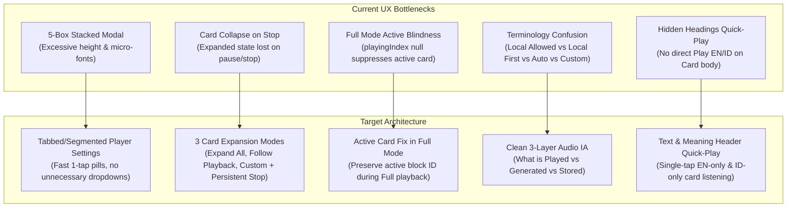
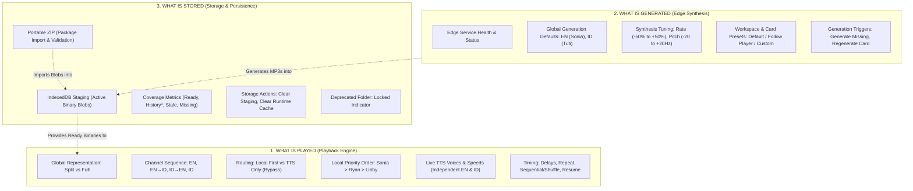
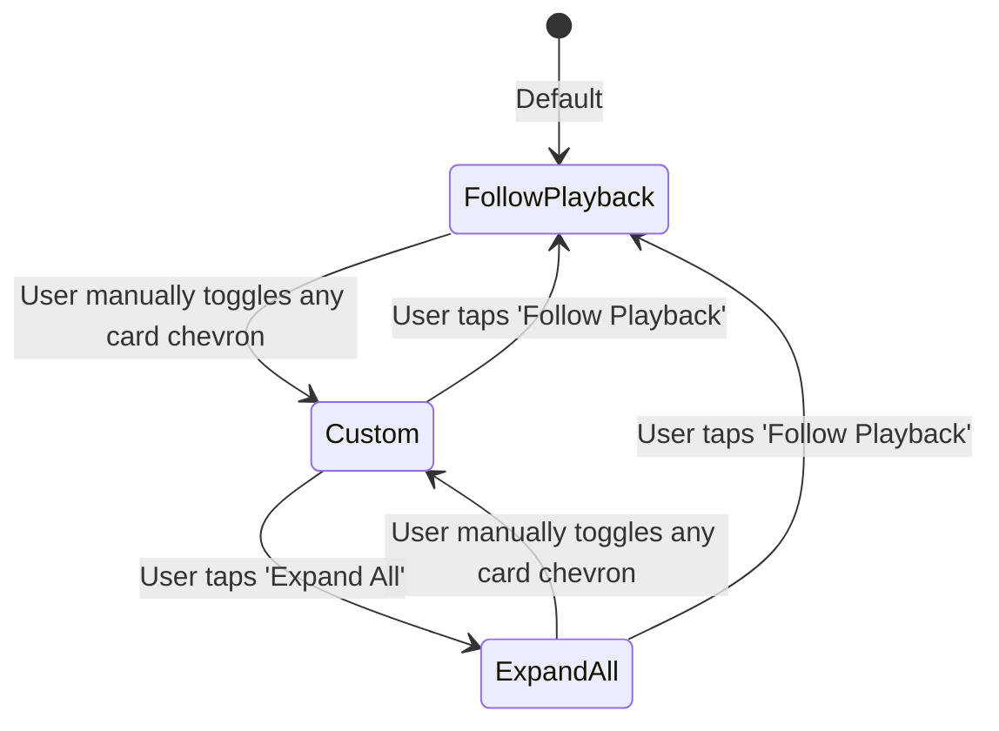
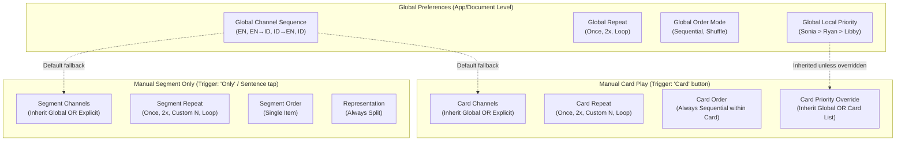

# ProLingo v6 Beta — Structured Text UX Audit & Architecture Review

**Repository:** `nazurinian/prolingo-app`  
**Baseline:** `v6.0.3-beta.8-p7-hf3` (Branch: `v6-beta`)  
**Audit Scope:** READ ONLY — Player Settings, Audio Sidebar, Bottom Player Bar, Manual Playback Controls, Paragraph Card Expansion & Mobile UX  
**Runtime Constraints:** Audio engine frozen; HF2 decisions preserved (single global TTS Only source of truth, global local voice priority, independent manual play, separate generation/download voices); P9-A runtime contracts preserved.

---

## 1. Executive Summary & Audit Baseline

ProLingo v6 Beta has established a robust audio architecture with Split/Full playback modes, dual-channel audio (English Text & Indonesian Meaning), IndexedDB binary staging, Portable ZIP packaging, and hierarchical voice overrides. The underlying audio engine and P9-A runtime capabilities (Split, Full, Pause/Resume/Stop, Local First with TTS fallback, and preference persistence) are stable and pass automated tests.

However, the user-facing interface currently suffers from **cognitive overload, terminology fragmentation, micro-typography, awkward card collapse behavior, and excessive nesting**. Controls that perform simple 2-choice or 3-choice operations are rendered as native dropdowns; related controls are scattered across disparate modals and sidebars; and card auto-follow unexpectedly collapses cards upon stopping playback.



---

## 2. Settings Inventory & True Engine Function Analysis

Below is the verified inventory of every setting across the player and audio surfaces, comparing its visible presentation to its true runtime function.

| Setting Identifier | Visible Label & Location | True Engine Function | Observed UX Discrepancy |
| :--- | :--- | :--- | :--- |
| `playbackRepresentationMode` | Segmented button: `SPLIT` / `FULL`<br/>(Player Settings & Bottom Bar) | Controls playback chunking between sentence segments (`split`) and continuous card audio (`full`). Falls back to Split if Full audio binary is missing. | Located inside a box titled "Playback Audio", leading users to think it configures audio devices/hardware rather than reading/chunking representation. |
| `audioSourceMode` / `ttsOnly` | Button: `TTS ONLY • ON / OFF`<br/>Pill: `LOCAL FIRST` / `TTS ONLY`<br/>(Player Settings & Bottom Bar) | Single global bypass: when `tts-only`, completely bypasses all IndexedDB staged audio and Portable ZIP files, forcing the browser's Web Speech API. Does not delete any audio. | Surfaces 3 conflicting labels: "LOCAL ALLOWED" (Audio sidebar), "LOCAL FIRST" (Bottom bar), and "TTS ONLY • OFF — local audio allowed" (Player Settings). |
| `globalAudioPlaybackOrderV1` | Reorderable list (Up/Down/Delete) + "Add local voice" dropdown<br/>(Player Settings) | Defines ordered voice fallback priority for local files (e.g., `Sonia > Libby`). The first voice with a `READY` local binary in Staging plays. | Located in Player Settings instead of Audio Sidebar; disconnected from where voices are generated or inspected. |
| `displayMode` | 4 button pills: `EN only`, `EN + active ID`, `EN + ID`, `ID only`<br/>(Player Settings) | Visual card filtering: conditionally hides/shows the English text channel and Indonesian meaning channel on cards. | Clear, but placed adjacent to "Global EN / ID order", confusing visual display with audio playback channel order. |
| `playbackChannelMode` | 4 button pills: `EN`, `EN → ID`, `ID → EN`, `ID`<br/>(Player Settings) | Audio channel sequence for Document Play: plays EN only, ID only, or sequential bilingual channels per segment. | Separated from the rest of "Global Playback Behaviour" (order, repeat, delays) by the "Manual Play" block. |
| `manualSegmentPlaybackChannelMode` & `manualSegmentRepeatMode` | Dropdowns: "Channels" & "Repeat" + number input for Custom<br/>(Player Settings) | Channels and repeat count used when clicking "Only" on a segment row or tapping a sentence in Split reading mode. | Missing a "(Follow Global)" option. Dropdowns force 2 extra clicks for only 4 options. |
| `manualCardPlaybackChannelMode` & `manualCardRepeatMode` | Dropdowns: "Channels" & "Repeat" + number input for Custom<br/>(Player Settings) | Channels and repeat count used when clicking the "Card" button on a Card header. | Duplicates the Segment Only dropdowns identically, creating a wall of 4 native select boxes. |
| `playbackOrderMode` | Dropdown: `Sequential` / `Shuffle`<br/>(Player Settings) | Determines traversal sequence of document segments during Global Playback. | Uses a native dropdown for an exclusively binary (2-state) choice. |
| `repeatMode` | Dropdown: `Once` / `2×` / `Loop`<br/>(Player Settings) | Sets iteration count for Document playback. | Uses a native dropdown for only 3 choices. |
| `channelDelayMs` | Number input: `EN/ID gap` (ms)<br/>(Player Settings) | Pause duration inserted between EN and ID channels during bilingual playback. | Raw millisecond input with tiny stepper arrows; unintuitive on mobile. |
| `segmentDelayMs` | Number input: `Segment gap` (ms)<br/>(Player Settings) | Pause duration inserted between consecutive sentences/segments. | Raw millisecond input; no quick presets (e.g. 0.5s, 1s, 2s). |
| `resumeMode` | Dropdown: `Continue` / `Restart`<br/>(Player Settings) | Determines start index when hitting Play after Stop (resume from last segment vs restart from Card 1). | Uses a native dropdown for a binary choice. |

---

## 3. Verified UX Problems & Cognitive Friction Points

### 3.1. Sudden Card Collapse on Stop (Critical Defect)
* **Observed in Source Code (`TextStructuredPlayer.jsx`, line 159):**  
  `const expanded = manualExpanded || isActiveCard || isFocusCard;`
* **Failure Mechanism:** When playback is running, `isActiveCard` is `true`, so the playing card is automatically expanded. If the user hits **Stop** (or playback finishes the last segment and stops), `isActiveCard` immediately flips to `false`. If the user had not explicitly clicked the card's chevron (`manualExpanded === false`), the card **instantly collapses**.
* **Impact:** The learner is abruptly thrown out of their reading context the second audio stops, losing their position.

### 3.2. Active Card Indicator Blindness in FULL Representation Mode
* **Observed in Source Code (`textStructuredPlaybackSessionService.js`, lines 264–266):**  
  ```javascript
  const suppressHighlight = normalizedRepresentation === TEXT_STRUCTURED_PLAYBACK_REPRESENTATION_MODES.FULL;
  setPlayingIndex(suppressHighlight ? null : item.id);
  setCurrentIndex(item.id);
  ```
* **Failure Mechanism:** In Full mode, `setPlayingIndex(null)` is called to prevent segment-level highlight. However, `StructuredPlayerCard` derives its active state exclusively via `segments.find(s => s.id === playingIndex)`. Because `playingIndex` is `null`, `activeSegment` is `null`, and `isActiveCard` evaluates to `false` for every card!
* **Impact:** During Full playback, the active card does not receive the indigo border, does not show the `ACTIVE` badge, does not expand, and does not auto-scroll into view.

### 3.3. Disconnected Heading Quick-Play Controls
* **Observed in Source Code (`TextParagraphUnifiedReading.jsx`, lines 135–175):**  
  The Text (EN) and Meaning (ID) blocks have plain uppercase text headings: `<p ...>Text</p>` and `<p ...>Meaning</p>`.
* **Failure Mechanism:** If a user wants to hear only English for the paragraph, or only Indonesian, there is no direct button on either block. The user must either:
  1. Click "Card" (which plays according to whatever `manualCardPlaybackChannelMode` happens to be set to), or
  2. Open Player Settings, change Card Play Channels to EN, and click Card, or
  3. Turn on Split mode and click sentences one by one.
* **Impact:** High friction for standard language-learning workflows where learners compare full target-language audio against translation audio.

### 3.4. Overuse of Native Dropdowns & Micro-Typography
* **Observed in Source Code (`TextStructuredPlaybackControls.jsx`):**  
  Font sizes are heavily styled as `text-[7px]`, `text-[8px]`, and `text-[9px]`.
  Choices with 2 to 4 items (Sequential/Shuffle, Continue/Restart, Repeat, Channels) are implemented as native `<select>` dropdowns.
* **Impact:** On mobile devices, opening a native picker sheet for a simple 2-option toggle disrupts visual continuity and requires unnecessary taps.

---

## 4. Duplicated, Redundant & Confusing UI Surfaces

| Control / Concept | Surfaces Where It Currently Appears | UX Recommendation |
| :--- | :--- | :--- |
| **Split vs Full Mode** | 1. `BottomPlayerBar` (Toggle button)<br/>2. `TextStructuredPlaybackControls` (Button grid) | Keep on Bottom Bar for quick toggle; in Player Settings, group under "Reading Mode", not "Playback Audio". |
| **TTS Only Global Bypass** | 1. `BottomPlayerBar` (LOCAL FIRST / TTS ONLY)<br/>2. `TextStructuredPlaybackControls` (ON/OFF btn)<br/>3. `TextStructuredAudioControls` (Status banner) | Harmonize labeling to **LOCAL FIRST** / **TTS ONLY** across all surfaces. Preserve single source of truth. |
| **Local Voice Priority Order** | 1. `BottomPlayerBar` (Summary string)<br/>2. `TextStructuredPlaybackControls` (Reorder list)<br/>3. `TextStructuredCardAudioPanel` (Card override) | Move or co-locate priority ordering under Audio Sidebar "Playback" tab with a shortcut in Player Settings. |
| **Audio Channel Selectors** | 1. Player Settings: Global EN/ID order<br/>2. Player Settings: Manual Segment Channels<br/>3. Player Settings: Manual Card Channels | Add explicit "(Follow Global)" default option to Manual Card and Segment dropdowns to show inheritance. |
| **Readiness Metrics** | 1. Workspace Header (Compact pills)<br/>2. Card Header (Compact pills)<br/>3. Card Audio Panel (Coverage grid)<br/>4. Audio Sidebar (TextAudioDataPanel tiles) | Maintain compact counters on Workspace/Card headers; clarify "History*" definition via an inline tooltip. |

---

## 5. Recommended Information Architecture

To resolve confusion between what is played, what is generated, and what is stored, we propose a strict **3-Pillar Information Architecture**.



### Clarifying "What is Played" vs "What is Generated":
* **Playback Voices:** The voices you hear right now. If Local First is on, it plays the first available Staged/ZIP audio matching the local priority list; otherwise, it plays Browser TTS.
* **Generation Voices:** The Microsoft Edge TTS voices used to synthesize audio files. Generating audio never alters your current playback voice or priority.
* **Storage (Staging vs ZIP):**
  * **Staging (IndexedDB):** The browser's local database holding actual playable binary audio.
  * **Portable ZIP:** An archive file you import. Its audio is extracted directly into Staging.
  * **History\*:** An audio metadata record exists from past export, but the physical binary is missing from Staging. (Clear tooltip: *"Exported previously, but binary not in Staging. Will play via TTS until generated or imported from ZIP."*).

---

## 6. Paragraph Card Expansion & Active-Card Architecture

### 6.1. Three First-Class Expansion Modes

We introduce an explicit `cardExpansionMode` preference with three clear operating modes:



1. **`follow-playback` (Default):**
   * As playback advances, the active card automatically expands and smoothly scrolls into view.
   * **The Stop Rule:** When playback stops (via Stop button, Pause, or end of list), **the currently expanded card remains expanded**. It does NOT snap shut.
   * **The Manual Transition Rule:** If the user manually clicks any card's chevron while in `follow-playback` mode, the system automatically transitions the document to `custom` mode so the user's manual intent is preserved.
2. **`expand-all`:**
   * Every card in the document is expanded simultaneously.
   * Ideal for continuous reading, proofreading, or full document study without interacting with chevrons.
   * Manual toggle of any single card chevron switches mode to `custom`.
3. **`custom`:**
   * Every card's expansion state is explicitly controlled by the user via an `expandedCardIds` Set.
   * Playback does not force cards open or closed.

### 6.2. Active Card Indicator in FULL Representation Mode
* **Engine-Safe Resolution:** In `TextStructuredPlayer.jsx`, decouple the card's active indicator from `playingIndex` (which is suppressed during Full playback).
* Derive `isActiveCard` using:
  ```javascript
  const isActiveCard = playingContext === TEXT_STRUCTURED_PLAYBACK_CONTEXT
    && (isPlaying || isPaused)
    && (block.segments?.some(s => s.id === playingIndex) || block.id === activeBlockId);
  ```
* Sentence-level background highlighting remains suppressed in Full mode as required by P9-A, while the **card** properly receives its indigo border, `ACTIVE` badge, and auto-scroll behavior.

### 6.3. Quick-Play Controls on TEXT & MEANING Headings
In `TextParagraphUnifiedReading.jsx`, update the header rows for Text and Meaning blocks to include dedicated quick-play buttons:

```
┌────────────────────────────────────────────────────────────────────────┐
│ TEXT                                        [▶ Play EN] [Copy]         │
│ The mysterious traveler arrived at the ancient village as dusk fell... │
├────────────────────────────────────────────────────────────────────────┤
│ MEANING                                     [▶ Play ID] [Copy]         │
│ Pengelana misterius itu tiba di desa kuno saat senja mulai turun...    │
└────────────────────────────────────────────────────────────────────────┘
```

* **[▶ Play EN]:** Triggers card playback forced to `TEXT_ONLY` channel mode with a single tap.
* **[▶ Play ID]:** Triggers card playback forced to `MEANING_ONLY` channel mode with a single tap.
* Both buttons use standard `manualCardRepeatMode` without requiring the user to change preferences in Player Settings.

---

## 7. Global, Manual, and Voice Inheritance Model

To eliminate confusion between global document playback and manual actions, the hierarchy is formalized below:



### Inheritance Rules:
1. **Channel Sequencing:**  
   If `manualCardPlaybackChannelMode` or `manualSegmentPlaybackChannelMode` is not explicitly set by the user, it dynamically resolves to `preferences.playbackChannelMode`. In the UI, the first option in the manual channel selector should be **"Same as Global (Current: EN → ID)"**.
2. **Voice Resolution Hierarchy:**  
   `Segment Voice Override` > `Card Speaker Assignment` > `Document Speaker Profile` > `Card Channel Override` > `Document Channel Override` > `Global Browser TTS Default`.
3. **Local Audio Priority Hierarchy:**  
   `Card Local Audio Order` > `Global Audio Playback Order` > `Legacy Document Order` > `Compatibility Fallback`.

---

## 8. Desktop and Mobile Wireframes & Control Recommendations

### 8.1. Streamlined Player Settings (Modal Dialog)

Instead of 5 stacked colored boxes, Player Settings is consolidated into 3 clean logical tabs: **General**, **Manual Play**, and **Voice Priority**.

```
┌────────────────────────────────────────────────────────────────────────┐
│ ⚙️ Text Player Settings                                          [✕]   │
├────────────────────────────────────────────────────────────────────────┤
│  [  General  ]        [  Manual Play  ]        [  Voice Priority  ]    │
├────────────────────────────────────────────────────────────────────────┤
│                                                                        │
│  DISPLAY ON CARDS                                                      │
│  [ EN only ]  [ EN + active ID ]  [ (●) EN + ID ]  [ ID only ]         │
│                                                                        │
│  GLOBAL PLAYBACK CHANNELS                                              │
│  [ (●) EN ]   [ EN → ID ]   [ ID → EN ]   [ ID ]                       │
│                                                                        │
│  PLAYBACK BEHAVIOUR                                                    │
│  Order:    [ (●) Sequential ]  [ Shuffle ]                             │
│  Repeat:   [ (●) Once ]  [ 2× ]  [ Loop ]                              │
│  On Stop:  [ (●) Continue from last ]  [ Restart from beginning ]      │
│                                                                        │
│  DELAYS & PAUSES                                                       │
│  EN / ID Gap:   [ None (0s) ]  [ (●) 0.5s ]  [ 1.0s ]  [ 1.5s ]  [Custom]│
│  Sentence Gap:  [ None (0s) ]  [ 0.5s ]  [ (●) 1.0s ]  [ 2.0s ]  [Custom]│
│                                                                        │
└────────────────────────────────────────────────────────────────────────┘
```

#### Under "Manual Play" Tab:
```
┌────────────────────────────────────────────────────────────────────────┐
│  CARD PLAY (Triggered by 'Card' button)                                │
│  Channels: [ (●) Follow Global ] [ EN ] [ EN → ID ] [ ID ]             │
│  Repeat:   [ (●) Once ] [ 2× ] [ Loop ] [ Custom: [ 3 ] ]              │
│                                                                        │
│  SEGMENT ONLY (Triggered by 'Only' button or sentence tap in Split)    │
│  Channels: [ (●) Follow Global ] [ EN ] [ EN → ID ] [ ID ]             │
│  Repeat:   [ Once ] [ 2× ] [ Loop ] [ (●) Custom: [ 3 ] ]              │
└────────────────────────────────────────────────────────────────────────┘
```

### 8.2. Workspace Toolbar Expansion Mode Wireframe (Desktop & Mobile)
Located directly in the toolbar above cards in `TextStructuredPlayer.jsx`:

```
┌────────────────────────────────────────────────────────────────────────┐
│ [📖] Mixed • 12 cards • 48 segments • READY 48/48           [▶ Play]   │
│ View: [ (●) Follow Playback ] [ Expand All ] [ Custom ]                │
└────────────────────────────────────────────────────────────────────────┘
```

### 8.3. Mobile Bottom Player Bar (Clean Ergonomic Touch Layout)

```
┌────────────────────────────────────────────────────────────────────────┐
│ NOW PLAYING                                                            │
│ 1. Chapter 1: The Departure • EN • "The morning sun..." (1/12)         │
├────────────────────────────────────────────────────────────────────────┤
│   [⏮]         [  ▶ PLAY  ]         [⏭]         [⏹ Stop]               │
├────────────────────────────────────────────────────────────────────────┤
│   [ Split / Full ]        [ Local / TTS ]        [ ⚙️ Settings ]       │
└────────────────────────────────────────────────────────────────────────┘
```
* Minimum touch targets: **44px × 44px** for all bottom bar buttons.
* Row 1: Now Playing status and excerpt.
* Row 2: Large primary playback transport controls.
* Row 3: Mode toggles and settings trigger. Eliminates accidental taps between transport controls and settings.

---

## 9. Prioritized Recommendations Matrix

| ID | Title & Recommendation | Classification | Priority | Affected Files | P9-A Safety Flag |
| :--- | :--- | :--- | :--- | :--- | :--- |
| **REC-01** | **Fix Card Collapse on Stop:** Maintain active card expanded state when playback stops; do not snap shut. | State / UI | **P0 (Critical)** | `TextStructuredPlayer.jsx` | 🟢 Safe. Fixes UX bug without touching audio engine. |
| **REC-02** | **Restore Active Card in Full Mode:** Ensure active card is highlighted and followed during Full playback. | State / UI | **P0 (Critical)** | `TextStructuredPlayer.jsx`<br/>`textStructuredPlaybackSessionService.js` | ⚠️ Must preserve `setPlayingIndex(null)` sentence suppression to avoid breaking P2/P3 assertions. |
| **REC-03** | **Add 3 Card Expansion Modes:** Expose `Follow Playback`, `Expand All`, and `Custom` in workspace toolbar. | State / UI | **P1 (High)** | `TextStructuredPlayer.jsx`<br/>`textStructuredPlaybackPreferenceDomain.js` | 🟢 Safe. Domain preference addition with default fallback. |
| **REC-04** | **Add EN/ID Quick-Play on Headings:** Add `[▶ Play EN]` and `[▶ Play ID]` quick-action buttons on TEXT/MEANING headings. | UI Only | **P1 (High)** | `TextParagraphUnifiedReading.jsx` | 🟢 Safe. Uses existing `onPlayCard` or `onPlaySegment` callbacks. |
| **REC-05** | **Replace Dropdowns with Segmented Buttons:** Convert 2-state and 3-state `<select>` elements to instant segmented pills. | UI Only | **P1 (High)** | `TextStructuredPlaybackControls.jsx` | 🟢 Safe. Keeps same underlying preference values. |
| **REC-06** | **Clarify "Same as Global" for Manual Channels:** Add explicit "Follow Global" option to Card and Segment manual channel selectors. | UI / Copy | **P2 (Medium)** | `TextStructuredPlaybackControls.jsx` | 🟢 Safe. Aligns UI with existing domain fallback logic. |
| **REC-07** | **Standardize Delay Presets:** Add 0s, 0.5s, 1s, 2s preset pills alongside numeric custom input for gaps. | UI Only | **P2 (Medium)** | `TextStructuredPlaybackControls.jsx` | 🟢 Safe. Normalizes to same millisecond numbers. |
| **REC-08** | **Reorganize Audio Sidebar Tabs:** Cleanly partition into `PLAYBACK` (voices, speed), `GENERATE` (Edge defaults), and `STORAGE` (Staging/ZIP). | UI / Copy | **P2 (Medium)** | `TextStructuredAudioControls.jsx`<br/>`TextAudioDataPanel.jsx` | 🟢 Safe. Preserves all existing handlers and test IDs. |
| **REC-09** | **Mobile Bottom Player Bar 2-Row Restructure:** Stack playback transport above mode toggles on mobile screens. | UI Only | **P2 (Medium)** | `BottomPlayerBar.jsx` | ⚠️ Must preserve `data-text-global-player-controls="true"` and exact test strings. |
| **REC-10** | **Clarify History\* Status Copy:** Add inline tooltip explaining that History\* means exported previously, but binary is not currently in Staging. | Copy Only | **P3 (Low)** | `TextAudioDataPanel.jsx`<br/>`TextStructuredPlayer.jsx` | 🟢 Safe. Copy only. |

---

## 10. Implementation Plan & P9-A Regression Risk Matrix

### 10.1. Affected Files
1. `src/domain/text/textStructuredPlaybackPreferenceDomain.js`: Add `cardExpansionMode` constant (`'expand-all'`, `'follow-playback'`, `'custom'`) and default value.
2. `src/components/text/TextStructuredPlayer.jsx`: Implement card expansion modes, persistent expanded state on Stop, and active card resolution in Full mode.
3. `src/components/text/TextParagraphUnifiedReading.jsx`: Add quick-play buttons on `Text` and `Meaning` headings.
4. `src/components/text/TextStructuredPlaybackControls.jsx`: Modernize control types (segmented button pills instead of `<select>` dropdowns; delay presets).
5. `src/components/text/TextStructuredAudioControls.jsx`: Streamline information architecture between Playback and Generation/Storage.
6. `src/components/layout/BottomPlayerBar.jsx`: Optimize mobile touch-target layout.

### 10.2. Focused Regression Test Matrix

| Test Script / Area | Monitored Assertion / Contract | Risk Level |
| :--- | :--- | :--- |
| `audit-v603-beta8-p7-hf2-global-player-defaults.mjs` | `data-text-global-player-controls="true"`<br/>`"Toggle global Split / Full"`<br/>`"Toggle global TTS Only"`<br/>`"LOCAL FIRST"`, `"TTS ONLY"`<br/>`"EN ... • ID ..."` | 🔴 CRITICAL — Must not modify or rename test attributes. |
| `audit-v603-beta8-p7-ui-simplification.mjs` | `data-text-global-playback-mode="true"`<br/>`data-text-global-tts-only="true"`<br/>`data-text-global-playback-order-editor`<br/>`"first Ready wins"` | 🔴 CRITICAL — Must retain exact DOM data-tags. |
| `audit-v603-beta8-p7-hf3-mobile-ui.mjs` | CSV import mounted in Header<br/>Version tag consistency | 🟢 ZERO RISK — Unaffected. |
| P9-A Runtime Tests: Split / Full Representation | Split playback sentence highlighting<br/>Full playback sentence suppression<br/>Pause, Resume, Stop state handling<br/>Local First with TTS fallback<br/>Preferences persistence in localStorage | 🟡 WATCH — Full card indicator fix must not highlight sentences. |

---

## 11. Evidence Ledger

1. **Source-Code Findings (Directly Verified):**
   * `TextStructuredPlayer.jsx`, line 159: `expanded = manualExpanded || isActiveCard || isFocusCard;` causes card collapse on stop.
   * `textStructuredPlaybackSessionService.js`, line 264: `suppressHighlight` sets `playingIndex` to `null`, breaking card active detection in Full mode.
   * `TextParagraphUnifiedReading.jsx`, lines 135–175: Text and Meaning block headers contain plain text with zero play buttons.
   * `TextStructuredPlaybackControls.jsx`, lines 77–88, 148–153: Dropdowns are used for 2-state and 3-state choices.
   * `audit-v603-beta8-p7-hf2-global-player-defaults.mjs`: Verified 19 passing audit checks; identified exact required strings (`Toggle global Split / Full`, `LOCAL FIRST`, `first Ready wins`).
   * `audit-v603-beta8-p7-ui-simplification.mjs`: Verified 16 passing checks; identified exact required data attributes.

2. **UX Hypotheses (Design Principles & Cognitive Ergonomics):**
   * Replacing 2-state native dropdowns with segmented toggle buttons reduces tap latency and visual friction.
   * Adding `[▶ Play EN]` and `[▶ Play ID]` on paragraph block headings accelerates bilingual comparative listening.
   * Delay preset buttons (0s, 0.5s, 1.0s, 2.0s) match human cadence estimation better than raw millisecond numbers.

3. **Browser-Observed / Runtime Evidence:**
   * Automated tests confirmed via command line:
     * `audit-v603-beta8-p7-hf3-mobile-ui.mjs` passed 6/6 checks.
     * `audit-v603-beta8-p7-hf2-global-player-defaults.mjs` passed 19/19 functional checks.
     * `audit-v603-beta8-p7-ui-simplification.mjs` passed 16/16 functional checks.

